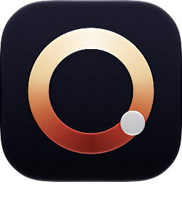
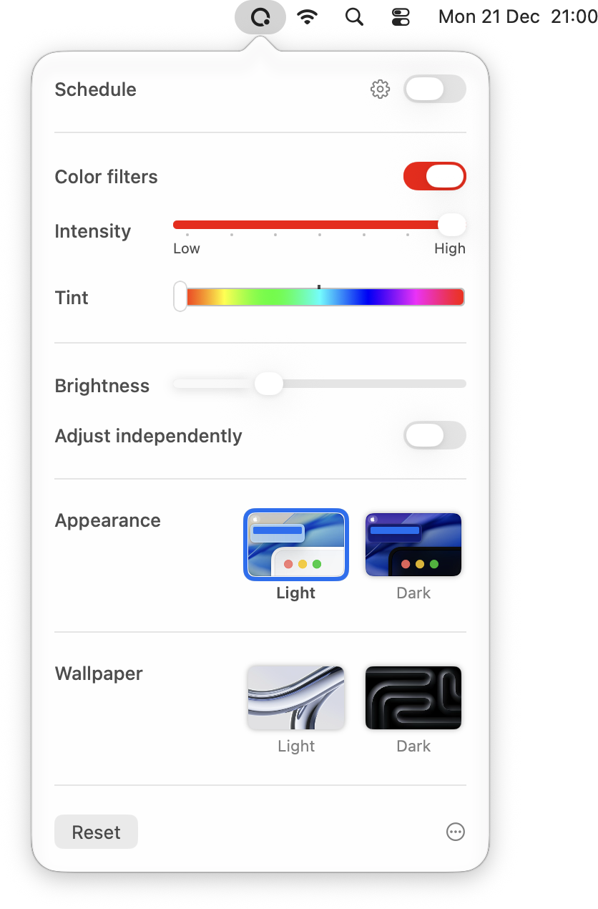

#  Safelight

Like Night Shift, but all the way to red.

<p align="center">
  
</p>

It lives in the menu bar.

<p align="center">
  <picture>
    <source media="(prefers-color-scheme: dark)" srcset="docs/popover-dark.png">
    
  </picture>
</p>

And follows your schedule.

<p align="center">
  <picture>
    <source media="(prefers-color-scheme: dark)" srcset="docs/schedule-dark.png">
    
  </picture>
</p>

With a wallpaper for Light and Dark.

<p align="center">
  <picture>
    <source media="(prefers-color-scheme: dark)" srcset="docs/wallpaper-dark.png">
    
  </picture>
</p>

## Features

- **A red that goes all the way.** Safelight drives macOS's own Color Tint filter (System Settings › Accessibility › Display › Color Filters), so everything on screen can go fully red, which Night Shift can't do.
- **[Brightness for every display](#brightness)**, together or each on its own, and darker than the backlight goes.
- **[Light and Dark, with a wallpaper for each](#appearance-and-wallpaper)**, and the desktop fades between them.
- **[One schedule for all of it](#schedule)**, at times you set or by sunrise and sunset.
- **Looks and speaks like macOS.** The controls are the ones System Settings uses, and every label is System Settings' own translation, so Safelight appears in your Mac's language.

### Brightness

What Safelight sets depends on the display:

| Display | What Safelight sets |
| --- | --- |
| One the Mac controls itself | Its backlight |
| An external monitor that takes DDC/CI, on Apple silicon | Its backlight, over the channel MonitorControl and Lunar use |
| Any other display | A darkened picture |
| An iPad on Sidecar | A dark layer over it |

- **Darker than the backlight goes.** Where Safelight sets the backlight, the top three quarters of the slider set it. Below the dot a quarter of the way along, the backlight stays at its lowest while the picture dims.
- **Each display on its own.** Set them all as one, or turn on Adjust Independently to give each its own, in the schedule too. A DDC/CI monitor's slider then follows the monitor's own buttons.
- **Brightness keys.** With Adjust Independently on, they set whichever display the pointer is on. That takes Accessibility permission, which macOS asks for when you turn it on.

### Appearance and wallpaper

- **Light and Dark.** Each time of day can switch the system's appearance.
- **A picture for each.** Choose one for Light and another for Dark, and the desktop fades between them whenever the appearance switches, whether through Safelight, System Settings, Control Center or Auto.
- **Where pictures come from.** macOS's own wallpapers, Photos, a file, or a shuffle of a set, each with the options System Settings gives it.
- **Aerials stay still**, as macOS only lets System Settings set moving ones.
- **Spaces and displays.** Safelight makes the two pictures one wallpaper, built like macOS's own Light and Dark wallpapers, so macOS does the switching itself on every Space and display. With Show on all Spaces off, it's on the Space you're on, where each display can have its own.

### Schedule

- **Times of day.** Add as many as you like. Each sets the color filter, intensity, tint, brightness and appearance.
- **Smooth fades.** The filter and brightness fade from one time to the next.
- **A preview of the day**, in a strip along the top.
- **Sunrise and Sunset.** Set Schedule to it and each time follows the sun instead (at sunrise or sunset, or a set time before or after), by Night Shift's sunrise and sunset for where you are, so the schedule moves with the seasons.

### Where things are

| To | Do this |
| --- | --- |
| Open the controls | Click the menu bar icon |
| Edit the schedule | Click the gear beside Schedule |
| Choose a wallpaper | Click the Light or Dark wallpaper |
| Find Open at Login, Automatic Updates, Check for Updates… and Quit | Right-click (or Control-click) the icon |

Reset and Quit both turn the color filter off and brightness back to full. Reset also turns the schedule off, while a schedule that was on when Safelight quit or the Mac restarted comes back on when Safelight opens.

## Install

Safelight needs macOS 15.5 or later, on Apple silicon or Intel.

1. Download the Safelight disk image (`.dmg`) from the [latest release](https://github.com/mopfaff/Safelight/releases/latest), open it, and drag Safelight onto the Applications folder beside it.
2. Open Safelight. It isn't notarized by Apple, so macOS says it can't check it for malware. Click **Done**.
3. Open **System Settings › Privacy & Security**, scroll down, and click **Open Anyway** next to the message about Safelight. Confirm with your password.

You only need to do this once. If you'd rather read the code first, all of Safelight's own code is in [`Safelight/Safelight.swift`](Safelight/Safelight.swift), and you can build it yourself.

### Updates

Safelight keeps itself up to date. Once a day it looks for a new release here, downloads it, and installs it once your Mac is locked and its screen has gone dark, or else the next time it quits, or when you log out or restart, so the screen never changes while you're using it. An update opens without the warning above, and Safelight only installs one signed with its own key. If you'd rather decide yourself, turn off Automatic Updates in the icon's right-click menu and choose Check for Updates… when you like. The updating is done by [Sparkle](https://sparkle-project.org), the open-source updater many Mac apps use.

## Build it yourself

You need Xcode 26 or later.

```bash
git clone https://github.com/mopfaff/Safelight.git
cd Safelight
scripts/release.sh
```

Xcode fetches Sparkle the first time. The app ends up in `build/release`. A copy you build yourself opens without the warning above, and updates itself to each new release like a downloaded one; turn off Automatic Updates to keep your own build. You can also open `Safelight.xcodeproj` in Xcode, choose your own team (or Sign to Run Locally) under Signing & Capabilities, and run it from there.

## How it works

Safelight doesn't draw anything over your screen. It changes the same settings System Settings does, through the functions System Settings itself calls. Those functions aren't part of Apple's public developer APIs, which is also why Safelight isn't on the Mac App Store, and a macOS update could change them. If something stops working after an update, please [open an issue](https://github.com/mopfaff/Safelight/issues).

## Support

Safelight is free and open source. If it's useful to you, you can support its development through [GitHub Sponsors](https://github.com/sponsors/mopfaff).

## License

Copyright © 2025–2026 mopfaff. Safelight is licensed under the [GNU General Public License v3.0](LICENSE).
