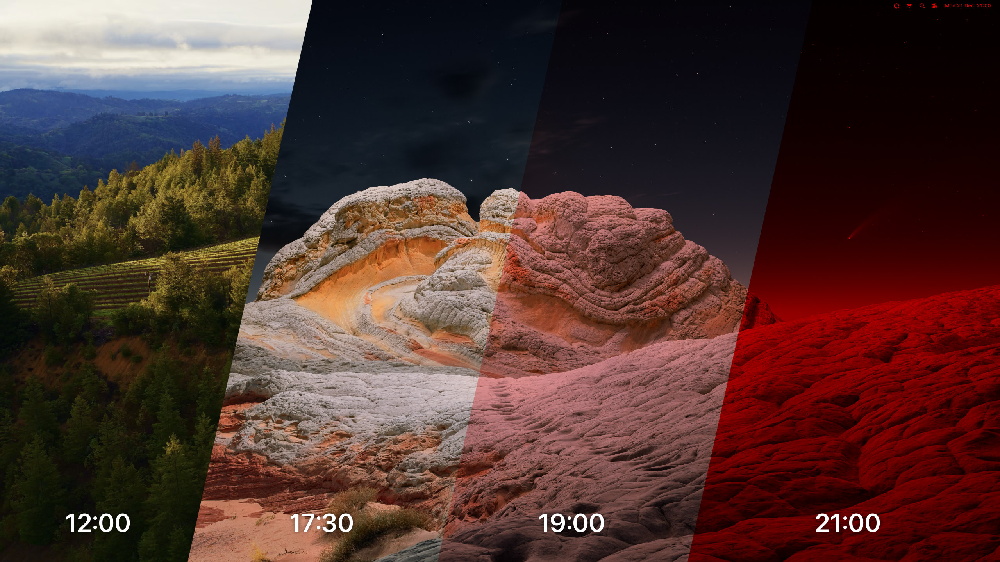
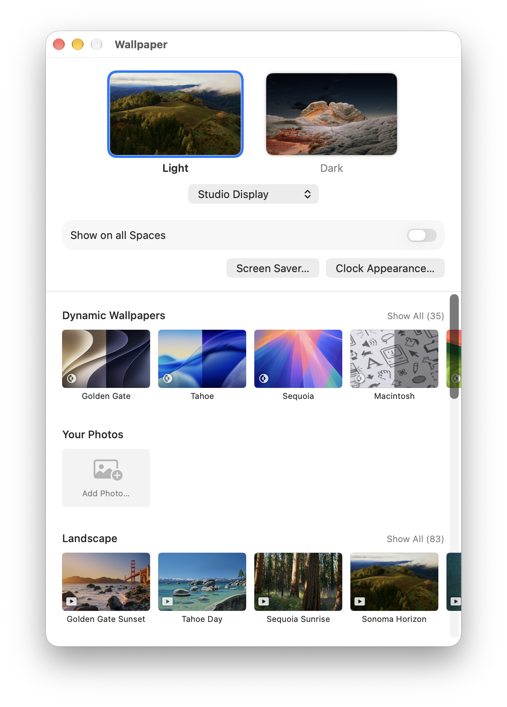

#  Safelight

Like Night Shift, but all the way to red.

<p align="center">
  
</p>

It lives in the menu bar.

<p align="center">
  <picture>
    <source media="(prefers-color-scheme: dark)" srcset="docs/popover-dark.png">
    
  </picture>
</p>

And follows your schedule.

<p align="center">
  <picture>
    <source media="(prefers-color-scheme: dark)" srcset="docs/schedule-dark.png">
    
  </picture>
</p>

With a wallpaper for Light and Dark.

<p align="center">
  <picture>
    <source media="(prefers-color-scheme: dark)" srcset="docs/wallpaper-dark.png">
    
  </picture>
</p>

## Features

<details>
<summary><b>A red that goes all the way</b></summary>

Safelight drives macOS's own Color Tint filter (System Settings › Accessibility › Display › Color Filters), so everything on screen can go fully red, which Night Shift can't do.

</details>
<details>
<summary><b>Brightness for every display</b></summary>

Set them all as one, or turn on Adjust Independently to give each its own, in the schedule too. Where it can, Safelight sets the backlight itself: on displays the Mac controls, and on Apple silicon on external monitors that take DDC/CI, the channel MonitorControl and Lunar use. With Adjust Independently on, such a monitor's slider follows the monitor's own buttons. These displays also go darker than their backlight allows: the top three quarters of the slider set the backlight, and below the dot a quarter of the way along it stays at its lowest while the picture dims. Other displays get a darkened picture only, and an iPad on Sidecar a dark layer over it.

</details>
<details>
<summary><b>Brightness keys for every display</b></summary>

With Adjust Independently on, the brightness keys set whichever display the pointer is on. That takes Accessibility permission, which macOS asks for when you turn it on.

</details>
<details>
<summary><b>Light and Dark, with a wallpaper for each</b></summary>

Each time of day can switch the system's appearance. Choose a picture for Light and another for Dark, and the desktop fades between them whenever the appearance switches, whether through Safelight, System Settings, Control Center or Auto. Pick from macOS's own wallpapers, from Photos or from a file, or shuffle a set, each with the options System Settings gives it. Aerials stay still, as macOS only lets System Settings set moving ones. Safelight makes the two one wallpaper, built like macOS's own Light and Dark wallpapers, so macOS does the switching itself on every Space and display, or, with Show on all Spaces off, on the Space you're on, where each display can have its own.

</details>
<details>
<summary><b>One schedule for all of it</b></summary>

Add as many times of day as you like. Each sets the color filter, intensity, tint, brightness and appearance, and the filter and brightness fade smoothly from one to the next. A strip along the top previews the whole day. With Schedule set to Sunrise and Sunset, each time follows the sun instead (at sunrise or sunset, or a set time before or after), by Night Shift's sunrise and sunset for where you are, so the schedule moves with the seasons.

</details>
<details>
<summary><b>Looks and speaks like macOS</b></summary>

The controls are the ones System Settings uses, and every label is System Settings' own translation, so Safelight appears in your Mac's language.

</details>

Click the menu bar icon for the controls, the gear beside Schedule to edit the schedule, and the Light or Dark wallpaper to choose its picture in the Wallpaper window. Right-click (or Control-click) the icon for Open at Login, Automatic Updates, Check for Updates… and Quit. Reset and Quit both turn the color filter off and brightness back to full. Reset also turns the schedule off, while a schedule that was on when Safelight quit or the Mac restarted comes back on when Safelight opens.

## Install

Needs macOS 15.5 or later, Apple silicon or Intel.

1. Download the `.dmg` from the [latest release](https://github.com/mopfaff/Safelight/releases/latest), open it, and drag Safelight to Applications.
2. Open Safelight. It isn't notarized, so macOS says it can't check it for malware. Click **Done**.
3. In **System Settings › Privacy & Security**, click **Open Anyway** and enter your password.

Once only. To read the code first: all of it is in [`Safelight/Safelight.swift`](Safelight/Safelight.swift), and you can build it yourself.

### Updates

Automatic, checked daily, installed while your Mac is locked or when Safelight quits. Signed with Safelight's own key, through [Sparkle](https://sparkle-project.org). To turn off: right-click the icon, Automatic Updates.

## Build it yourself

Needs Xcode 26 or later.

```bash
git clone https://github.com/mopfaff/Safelight.git
cd Safelight
scripts/release.sh
```

The app lands in `build/release`. It updates itself like a downloaded copy; turn off Automatic Updates to keep your build. Or open `Safelight.xcodeproj` in Xcode and run it with your own team, or Sign to Run Locally.

## How it works

No overlay: Safelight changes the same settings System Settings does, through the same private functions. So it isn't on the Mac App Store, and a macOS update could break it. If one does, [open an issue](https://github.com/mopfaff/Safelight/issues).

## Support

Free and open source. If it's useful to you: [GitHub Sponsors](https://github.com/sponsors/mopfaff).

## License

[GPL-3.0](LICENSE). © 2025–2026 mopfaff.
