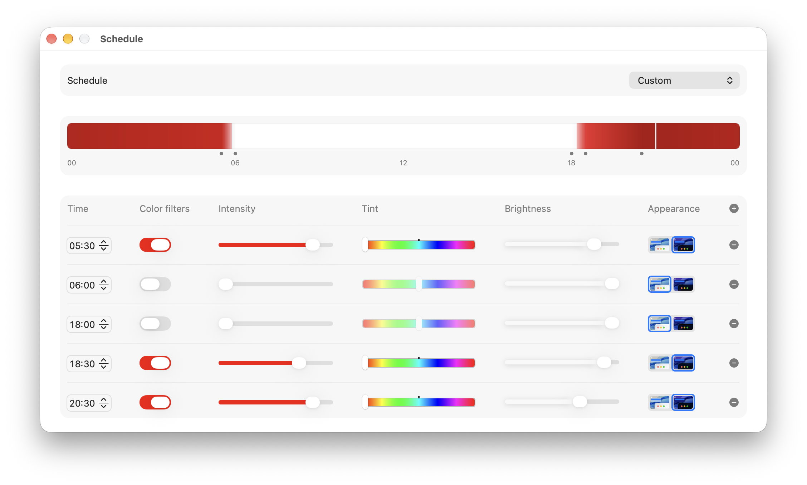

<h3>Safelight</h3>

<p>Schedules macOS's color filter to full red, brightness, and Light/Dark wallpapers.
Built-in and external (DDC/CI) displays, dimming below minimum, and sunrise/sunset.</p>

<a href="https://github.com/mopfaff/Safelight/releases/latest/download/Safelight-1.0.dmg"><picture><source media="(prefers-color-scheme: dark)" srcset="docs/download-macos-dark.png"></picture></a>

<br clear="left">

<p align="center">
  <sub>macOS 15.5+ · Free &amp; open source · <a href="#install">First-launch &amp; Homebrew</a> · <a href="https://mopfaff.github.io/Safelight/">Website</a></sub>
</p>

<p align="center">
  
</p>

It lives in the menu bar.

<p align="center">
  <picture>
    <source media="(prefers-color-scheme: dark)" srcset="docs/popover-dark.png">
    
  </picture>
</p>

And follows your schedule.

<p align="center">
  <picture>
    <source media="(prefers-color-scheme: dark)" srcset="docs/schedule-dark.png">
    
  </picture>
</p>

With a wallpaper for Light and Dark.

<p align="center">
  <picture>
    <source media="(prefers-color-scheme: dark)" srcset="docs/wallpaper-dark.png">
    
  </picture>
</p>

## Features

<details>
<summary><b>A red that goes all the way</b></summary>

Drives macOS's own Color Tint filter (System Settings › Accessibility › Display › Color Filters), so the whole screen goes fully red—further than Night Shift can.

</details>
<details>
<summary><b>Brightness for every display</b></summary>

- **Hardware backlight:** Sets the backlight directly on displays the Mac controls and—on Apple silicon—external monitors with DDC/CI (like MonitorControl and Lunar). Other displays dim the picture; a Sidecar iPad gets a dark layer.
- **Darker than minimum:** Below the dot a quarter of the way along, the backlight stays at its lowest while the picture dims further.
- **Adjust Independently:** Gives each display its own slider (in the schedule too), and DDC sliders follow the monitor's own buttons.

</details>
<details>
<summary><b>Brightness keys for every display</b></summary>

With Adjust Independently on, the brightness keys control whichever display the pointer is on. Needs Accessibility permission, requested when you turn it on.

</details>
<details>
<summary><b>Light and Dark, with a wallpaper for each</b></summary>

- **Sources:** Pick from macOS's wallpapers, Photos, files, or a shuffle, with System Settings' options. Aerials stay still, as only System Settings can set moving ones.
- **Native switching:** Each scheduled time can switch Light and Dark appearance. Safelight combines your two picks into one Light/Dark wallpaper, so macOS fades between them itself on any change—Safelight, System Settings, Control Center, or Auto.
- **Spaces & displays:** Applies across all Spaces and displays, or turn off Show on all Spaces to set the current Space (with a separate pair per display).

</details>
<details>
<summary><b>One schedule for all of it</b></summary>

- **Times & fades:** Add as many times of day as you like, each with its own color filter, intensity, tint, brightness, and appearance. Filter and brightness fade smoothly between them, with a preview strip of the day along the top.
- **Sunrise & sunset:** Set Schedule to Sunrise and Sunset to anchor times to Night Shift's sunrise and sunset for your location (at, before, or after), so they shift with the seasons.

</details>
<details>
<summary><b>Looks and speaks like macOS</b></summary>

Uses System Settings' own controls and translations, so Safelight appears in your Mac's language.

</details>

## Install

Needs macOS 15.5 or later, Apple silicon or Intel.

```bash
brew install --cask mopfaff/tap/safelight
```

Or download the `.dmg` from the [latest release](https://github.com/mopfaff/Safelight/releases/latest), open it, and drag Safelight to Applications.

On first launch (Safelight isn't notarized):

1. Open Safelight. macOS says it can't check it for malware. Click **Done**.
2. In **System Settings › Privacy & Security**, click **Open Anyway** and enter your password.

Once only. To read the code first: all of it is in [`Safelight/Safelight.swift`](Safelight/Safelight.swift), and you can build it yourself.

### Updates

Automatic, checked daily, installed while your Mac is locked or when Safelight quits. Signed with Safelight's own key, through [Sparkle](https://sparkle-project.org). To turn off: right-click the icon, Automatic Updates.

## Build it yourself

Needs Xcode 26 or later.

```bash
git clone https://github.com/mopfaff/Safelight.git
cd Safelight
scripts/release.sh
```

The app lands in `build/release`. It updates itself like a downloaded copy; turn off Automatic Updates to keep your build. Or open `Safelight.xcodeproj` in Xcode and run it with your own team, or Sign to Run Locally.

## How it works

No overlay: Safelight changes the same settings System Settings does, through the same private functions. So it isn't on the Mac App Store, and a macOS update could break it. If one does, [open an issue](https://github.com/mopfaff/Safelight/issues).

## Support

Free and open source. If it's useful to you: [GitHub Sponsors](https://github.com/sponsors/mopfaff).

## License

[GPL-3.0](LICENSE). © 2025–2026 mopfaff.
